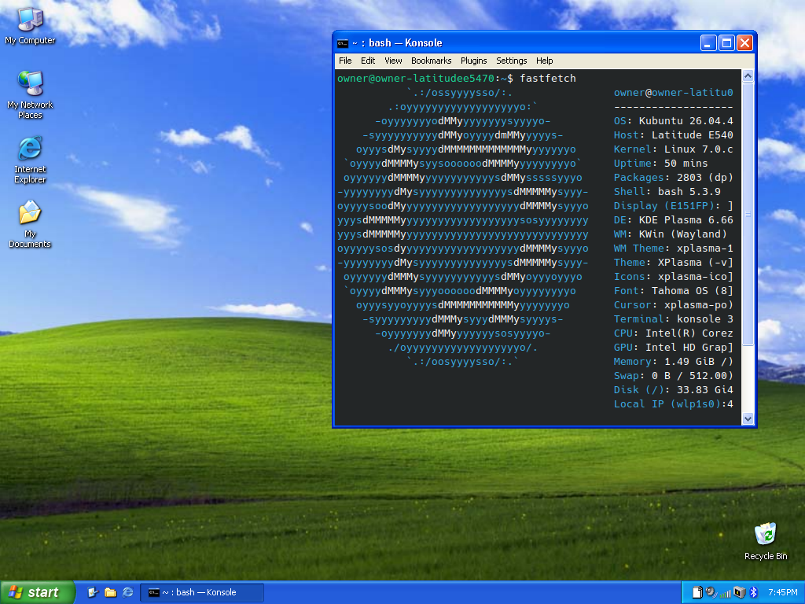
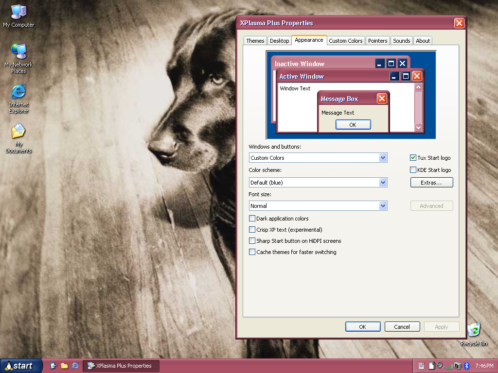
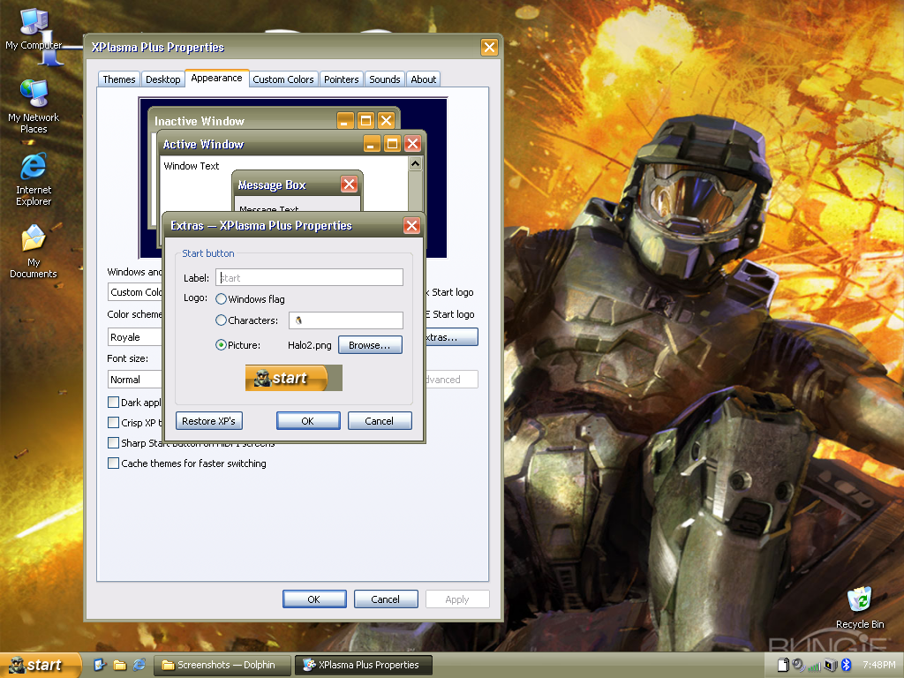
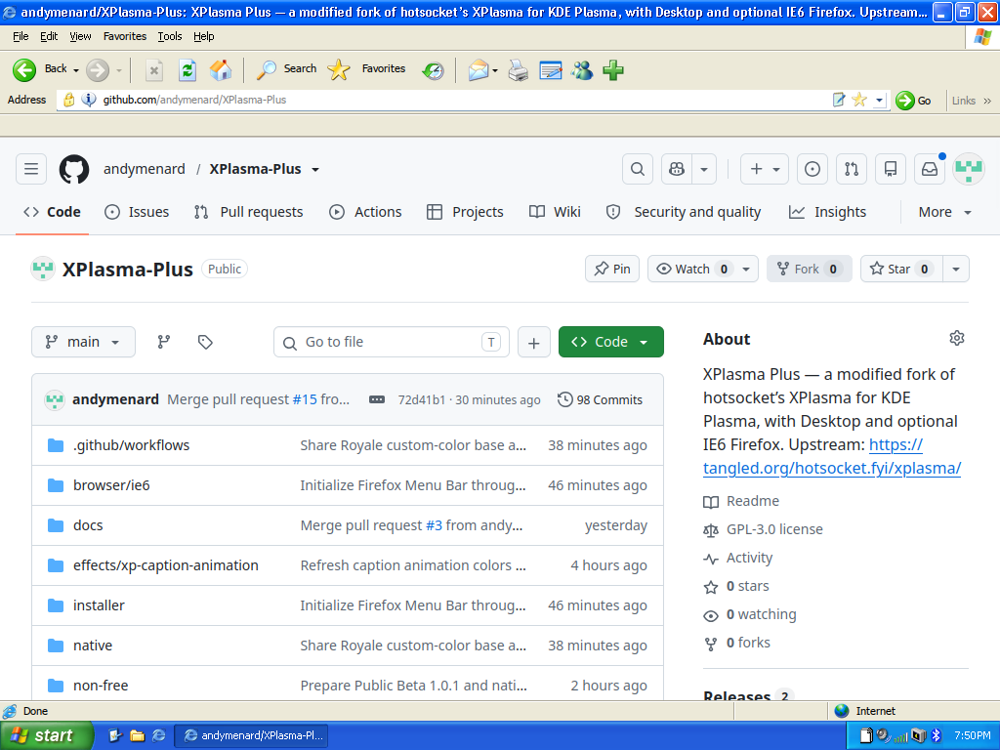
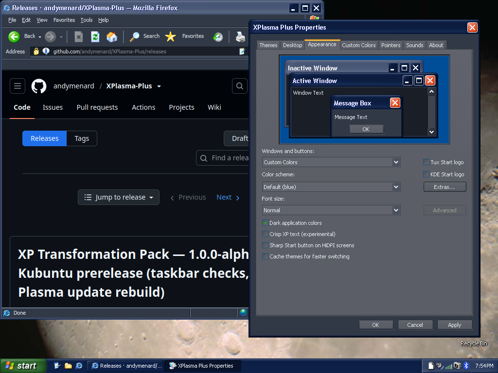
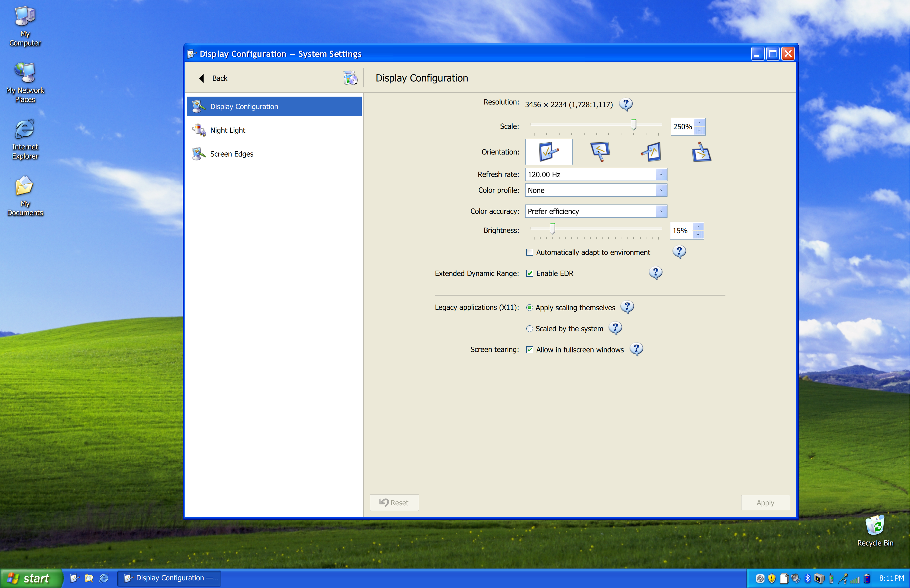
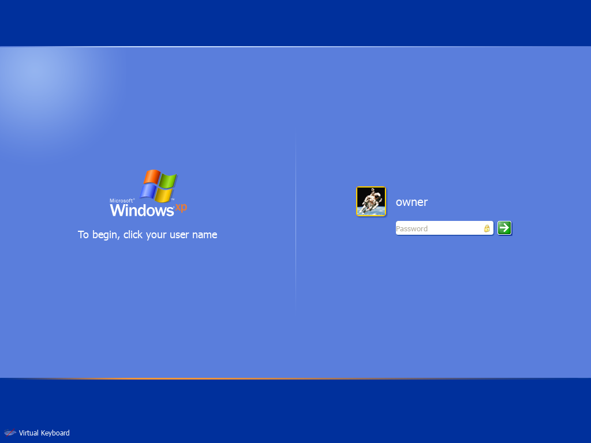
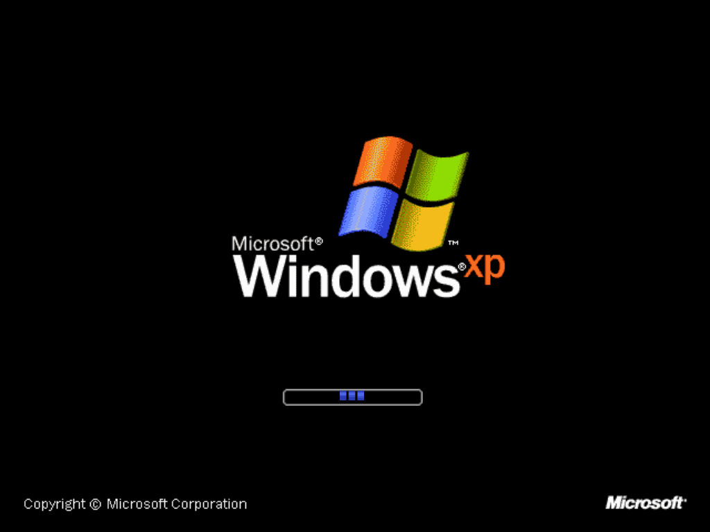

> [!WARNING]
> **This project is vibecoded.** Hands-on testing has been limited to **Asahi Linux (ARM64)** and **Kubuntu on Intel/AMD x86-64**. Issues are expected; builds for other platforms do not mean they have been tested on real hardware. **I do not recommend installing this on a computer without backing up your data and system configuration first. While I personally run this on my main computers and have tried my best to audit the code, I am not a software engineer.**

# XPlasma Plus — 1.0.1 Public Beta

This is a project I've been working on for personal use that I wanted to share with anyone else who might enjoy it. This is a KDE Plasma transformation pack and **modified fork of [hotsocket's XPlasma](https://tangled.org/hotsocket.fyi/xplasma/)**. The native visual-style engine, Qt style, Properties editor and desktop generators are forked from that. This repository contains our (me and AI's) ports, integration and changes; it does not claim authorship of the upstream foundation.

Also check out **[Rozniak's Windows XP Total Conversion for XFCE](https://github.com/rozniak/xfce-winxp-tc)**, the main inspiration for this project. If you enjoy bringing the XP experience to Linux and are partial to XFCE, give Rozniak's project a look.

The alpha includes the XP desktop by default and the IE6 Firefox theme as an option. There are currently no XP remake applications included, but I may include them in the future. 

## Tutorials

New to XPlasma Plus? Follow the **[tutorial wiki](https://github.com/andymenard/XPlasma-Plus/wiki)** for installation, desktop customization, IE6 Firefox, lock/login/boot screens, upgrades, removal and troubleshooting. A [copy of the tutorials](docs/wiki/Home.md) is also kept in this repository.

## Screenshots

### Default theme

The default Windows XP desktop theme on Kubuntu.

### Custom colors

Customize the theme colors in XPlasma Plus Properties.

### Customizable Start button

Choose your own Start button logo and appearance.

### Internet Explorer appearance

The optional IE6 replica theme for Firefox ESR.

### Dark mode

Dark application colors with a matching Firefox theme.

### HiDPI support

The XP desktop on a HiDPI display at 250% scaling.

### Lock screen

### Boot screen

## Licence

The source code in this repository — essentially any *text* files, such as C++, QML, Python, JavaScript and shell scripts — is licensed under the GPL; see [LICENSE](LICENSE). Reused components keep their own notices and licenses: read [CREDITS.md](CREDITS.md), [native/THIRD-PARTY-NOTICES](native/THIRD-PARTY-NOTICES) and [installer/THIRD-PARTY-NOTICES](installer/THIRD-PARTY-NOTICES). This modified project is not endorsed by upstream developers or Microsoft.

This licence does **not** cover the assets from Windows XP (images, icons, cursors, sounds, fonts and visual styles): those are still Microsoft's copyright. They are in this repository for convenience, all in one folder, [`non-free/`](non-free/NOTICE.md), and the installer marks the components that use them as non-free. Windows program files and installers, third-party stock photographs and the high-resolution photo rescans are not in the repository. See [ASSET-DISTRIBUTION.md](ASSET-DISTRIBUTION.md).

## Builds

The complete installer is provided separately as an alpha prerelease asset, with its resources' copyright notices; this source checkout alone is not that full installer.

Build Desktop with `cmake -S native -B build/desktop -G Ninja -DQT_MAJOR=6` and `cmake --build build/desktop`. Native components must match the receiving machine's KDE/Qt. The optional browser sources are under `browser/ie6`. Source includes the caption effect and original third-party notices.

## New releases

Prereleases use complete installer downloads. OTA updates are not included and
there is no background update client. **Download New Releases** in Properties
opens the GitHub releases page in your browser. Signed checksums are provided
for verifying each installer download.

Read the new release's installation and migration notes before changing an
existing installation. Choose **Upgrade installation** to keep the original
rollback backup, selected features, theme and toolbar preferences.

## Download the installer

See [1.0.1 Public Beta](https://github.com/andymenard/XPlasma-Plus/releases/tag/v1.0.1).
Extract the installer tar.gz, then launch **Start-Installer.desktop** from the
extracted folder as your desktop user. Linux dependencies require internet
access; an XP ISO is not needed. Desktop is selected by default; Firefox is optional.
This is a public beta: please report problems on the repository's issue tracker.
Compatibility notes are in the release notes. Signed checksums authenticate the
installer download; this release does not activate an OTA payload.

## Installer variants

| Download | Prebuilt target |
| --- | --- |
| [Kubuntu x86-64](https://github.com/andymenard/XPlasma-Plus/releases/download/v1.0.1/xplasma-plus-1.0.1-installer-kubuntu-26.04-amd64.tar.gz) | Kubuntu/Ubuntu 26.04, Intel/AMD 64-bit |
| [Kubuntu ARM64](https://github.com/andymenard/XPlasma-Plus/releases/download/v1.0.1/xplasma-plus-1.0.1-installer-kubuntu-26.04-arm64.tar.gz) | Kubuntu/Ubuntu 26.04, ARM64 |
| [Fedora x86-64](https://github.com/andymenard/XPlasma-Plus/releases/download/v1.0.1/xplasma-plus-1.0.1-installer-fedora-44-amd64.tar.gz) | Fedora 44, Intel/AMD 64-bit |
| [Fedora ARM64](https://github.com/andymenard/XPlasma-Plus/releases/download/v1.0.1/xplasma-plus-1.0.1-installer-fedora-44-arm64.tar.gz) | Fedora 44 and matching Fedora Asahi Remix 44, ARM64 |
| [Generic](https://github.com/andymenard/XPlasma-Plus/releases/download/v1.0.1/xplasma-plus-1.0.1-installer-generic.tar.gz) | Builds locally on supported KDE systems |

Prebuilt components are used only when the distribution, architecture, Qt,
Plasma and source identity match; otherwise the installer builds locally.
The caption effect additionally checks the exact KWin build. All variants
include the same desktop features, optional Firefox theme and source fallback.
The generic installer supports APT, DNF, pacman and Zypper families; the bundled
native Plasma integrations currently target Plasma 6.6/Qt 6.10 and
Plasma 6.7/Qt 6.11 or newer Qt within the supported Plasma series. Other versions
may have unavailable components. Dependency installation needs internet access.

## Boot splash troubleshooting

If the boot splash stays black or flickers, see [Boot splash troubleshooting](BOOT-SPLASH-TROUBLESHOOTING.md) for the optional Intel early-driver workaround confirmed on a docked laptop. This is a manual troubleshooting step; the installer does not apply it automatically.

## Interface fonts

The installer includes **Tahoma OS** regular and bold, renamed from Microsoft
Tahoma to separate XP interface rendering from smooth Tahoma app content. The
font assets retain their separate Microsoft rights; see
[font provenance and notices](installer/assets/fonts/tahoma-os/NOTICE.txt).
